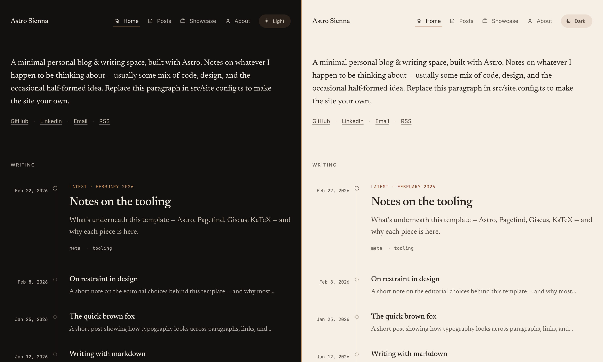
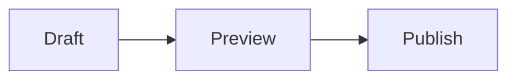

# Astro Sienna

A minimal blog theme for Astro with serif typography, light and dark modes, RSS, generated OG images, and optional
comments and analytics.

Live demo: [anjay-goel.github.io/aningdev](https://anjay-goel.github.io/aningdev)



## Features

- Astro 7 content collections for posts and pages, with Zod-validated frontmatter
- Markdown and MDX posts (MDX lets you use components, imports and expressions)
- Light and dark themes that follow the system setting, with a toggle that remembers your choice
- Self-hosted fonts: [Newsreader](https://github.com/productiontype/Newsreader) for text, Inter for UI, JetBrains Mono
  for code
- Code blocks via [Expressive Code](https://expressive-code.com), with a copy button, terminal frames and line
  highlighting
- KaTeX math, Pele diagrams (Mermaid syntax) and admonitions (`:::note`, `:::tip` and friends)
- Tag pages and a `/tags/` index
- A 1200×630 OG image for every post, generated at build time with Satori and resvg
- RSS feed, sitemap and robots.txt
- Pagefind index built after every production build
- Optional [Giscus](https://giscus.app) comments, and GA4 or GoatCounter analytics

## Quick start

Click **Use this template** on GitHub, or clone it:

```sh
git clone https://github.com/anjay-goel/aningdev.git my-site
cd my-site
pnpm install
pnpm dev
```

Then open http://localhost:4321.

| Command        | What it does                                        |
| -------------- | --------------------------------------------------- |
| `pnpm dev`     | Start the dev server                                |
| `pnpm build`   | Type-check, build to `dist/`, then run Pagefind     |
| `pnpm preview` | Serve the production build locally                  |
| `pnpm test`    | Run the tests in `tests/` with the Node test runner |
| `pnpm lint`    | Lint with Biome                                     |
| `pnpm format`  | Format with Oxfmt                                   |

## Configuration

Most settings live in `src/site.config.ts`: title, description, author, date format, profile links, comments,
analytics. Every `profile` field except `name` is optional, and any link you leave out is hidden.
`comments` and `analytics` are commented out by default. Nothing loads until you fill them in.

Dates are formatted in UTC. To use another zone, set `date.options.timeZone` (for example `"Asia/Kolkata"`). Set
`sortPostsByUpdatedDate: true` to order posts by `updatedDate` when it exists, and `hideThemeCredit: true` to drop the
theme credit from the footer.

Replace these files in `public/`:

- `icon.png` (512×512): the favicon
- `social-card.png` (1200×630): the OG image for pages that aren't posts
- `avatar.png` (optional): point `profile.avatar` at it to include it in the About page's structured data

The About page is `src/content/page/about.md`. Showcase entries are in `src/data/showcase.ts`. If that array is empty,
the Showcase link is hidden.

## Writing posts

Posts are `.md` or `.mdx` files in `src/content/post/`. The filename becomes the URL slug.

```yaml
---
title: "Your post title"
publishDate: 2026-01-12
description: "One-sentence summary for cards, social previews and meta tags."
tags: [tag-one, tag-two]
updatedDate: 2026-02-01
draft: true
ogImage: "/images/custom-card.png"
coverImage:
  src: ./_assets/cover.png
  alt: "Description for screen readers"
---
```

Only `title`, `publishDate` and `description` are required. `description` must be 10 to 160 characters. Dates can be
quoted or unquoted. `updatedDate` shows an "Updated" line and sets the post's `lastmod` in the sitemap (otherwise
`publishDate` is used). Drafts show up in `pnpm dev` but are left out of production builds. `ogImage` replaces the
generated OG image. To change the generated card for every post, edit `src/pages/og-image/[...slug].png.ts`.

Links and images that start with `/` get the base path added automatically. External links open in a new tab. Wide
tables scroll sideways instead of stretching the page.

### Posts published elsewhere

To list a post that lives on another site, add `externalUrl` to its frontmatter and leave the body empty:

```yaml
---
title: "A post I wrote for the company blog"
publishDate: 2026-01-20
description: "One-sentence summary for cards and the RSS feed."
externalUrl: "https://example.com/blog/my-post/"
---
```

The post shows up in the home page, archive, tag pages and RSS feed like any other, with an external-link icon after
its title, and links straight to `externalUrl`. Its own `/posts/<slug>/` URL redirects there and is left out of the
sitemap. See `src/content/post/content-collections-in-astro.md`.

### Math

Write `$inline$` or `$$display$$` math. KaTeX renders it at build time, and the KaTeX stylesheet is only loaded on
posts that contain math.

### Diagrams

Use a `mermaid` code fence in a `.md` or `.mdx` post:

````markdown

````

Only posts with a diagram include the loader script. [Pele](https://pele.run) draws the diagram from the site's own
assets and loads when the first diagram comes within 200px of the viewport. Colours and fonts come from CSS variables,
so they follow the current theme without a redraw. Pele refits the layout to the frame, and a drawing that is still
wider scrolls inside it. If JavaScript is off or a diagram has a syntax error, the source text stays on the page.
Diagram source is excluded from the Pagefind index. Add `accTitle` and `accDescr` for screen readers.

See `src/content/post/diagrams-with-mermaid.md` for flowchart, sequence, state and entity-relationship examples.

### Admonitions

```markdown
:::tip[Optional custom title]
Body text.
:::
```

The types are `note`, `tip`, `important`, `caution` and `warning`.

## Theming

Colors and fonts are CSS variables at the top of `src/styles/global.css`, with separate blocks for
`[data-theme="light"]` and `[data-theme="dark"]`. Code block themes and colors are set in `expressiveCodeOptions` in
`src/site.config.ts` (the defaults are `min-light` and `min-dark`).

## Deploying

`pnpm build` writes a static site to `dist/`, so any static host works.

Set `SITE_URL` to your site's origin when you build. It is used for canonical URLs, OG images, the sitemap and RSS.
The GitHub Pages workflow (`.github/workflows/deploy.yml`) and `netlify.toml` set it for you. Elsewhere, run
`SITE_URL=https://example.com pnpm build`, or change the fallback in `astro.config.ts`.

The base path defaults to `/`, which is right for a custom domain, Netlify, Vercel, Cloudflare Pages or a GitHub Pages
user site. For a GitHub Pages project site served from `/repo/`, the deploy workflow detects the subpath and sets
`BASE_PATH` for you. You only need to set **Settings > Pages > Source** to **GitHub Actions**. On other hosts, build
with `BASE_PATH=/sub pnpm build`.

## Comments and analytics

- **Giscus**: fill in `comments` in `src/site.config.ts` with the values from the [Giscus setup page](https://giscus.app).
  The widget follows the site theme, using the stylesheets in `public/giscus-*.css` in production builds.
- **Analytics**: set `analytics.googleAnalyticsId`, `analytics.goatcounterUrl`, or both. GA4 runs in a web worker
  through [Partytown](https://partytown.qwik.dev/), which is only added to the build when a GA4 ID is set.
  GoatCounter loads its `count.js` as a normal async script.

## Pulling theme updates

Add this repo as a second remote and merge from it:

```sh
git remote add theme https://github.com/anjay-goel/aningdev.git
git fetch theme
git merge theme/main --allow-unrelated-histories
```

To keep your own versions of files like `src/content/post/*` or `src/site.config.ts` during the merge, mark them
`merge=ours` in `.gitattributes` and enable the driver with `git config merge.ours.driver true`.

## Credits

Started as a fork of [astro-theme-cactus](https://github.com/chrismwilliams/astro-theme-cactus) by
[Chris Williams](https://github.com/chrismwilliams) and has been largely rewritten since.

## License

[MIT](./LICENSE)
