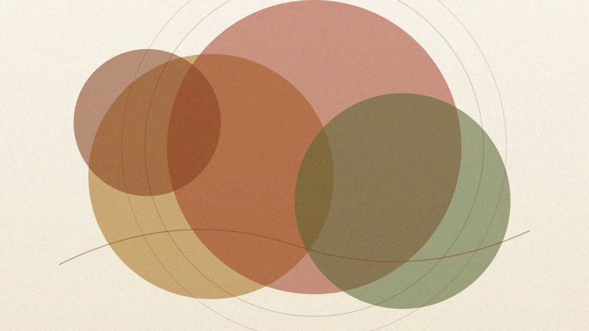

这是一篇「样式展示」样例文：用完整、可读的中文把本站已经接线的 Markdown 能力过一遍。正文主字体为霞鹜文楷（LXGW WenKai）；代码仍用等宽字体。下面从标题层级开始。

# 一级标题（文内 h1）

页面标题已是文章名；文内再写一级标题时，样式仍按引擎输出的 `h1` 渲染。日常写作更常见从二级起笔。

## 二级标题

二级用于划分大段。本段示范普通段落：落霞与孤鹜齐飞，秋水共长天一色。排版应舒适易读，而不是堆砌装饰。

### 三级标题

三级适合小节。你可以在同一句里混用 **加粗**、_斜体_、_**加粗斜体**_、~~删除线~~，以及行内代码如 `const answer = 42`。

#### 四级标题

四级再往下，层级更细。外链示例：[Astro 文档](https://docs.astro.build)；站内相对路径也可指向其他文章，例如 [Writing with markdown](/posts/writing-with-markdown/)。

##### 五级标题

五级标题字号更接近正文，适合极细的结构标注。

###### 六级标题

六级是本站样式表里最末一级标题；再往下就没有对应排版了。

---

## 引用

> 引用块左侧有竖线，整体略偏斜体与弱化色。
>
> 多段引用也能连续排开：读书忌死记，写作忌堆砌。

引用里也可以夹 **强调** 与 `代码`。

## 列表

无序列表：

- 春种一粒粟
- 秋收万颗子
  - 嵌套：先整地
  - 嵌套：再播种
- 四海无闲田

有序列表：

1. 起草大纲
2. 写初稿
   1. 搭结构
   2. 补细节
3. 改第二稿
4. 定稿发布

任务列表（若渲染为可勾选样式，即表示 GFM task list 已生效）：

- [x] 接好字体与主题变量
- [x] 写中文样式样例
- [ ] 按需再补更多文章

## 代码

行内：用 `pnpm dev` 或 `bun run build` 启动本地预览。

带语言的围栏代码（Expressive Code 高亮 + 复制按钮）：

```ts
/** 把标题收成适合卡片展示的短句 */
export function summarize(title: string, max = 48): string {
  const trimmed = title.trim();
  return trimmed.length <= max ? trimmed : `${trimmed.slice(0, max - 1)}…`;
}
```

```bash
# 安装依赖并做一次生产构建
bun install
bun run build
```

## 图片

正文图片走 Astro 资源管线（缩放、现代格式、懒加载）。下面复用仓库里已有的帖内资源：




## 表格

| 能力     | 本站现状                 | 调整入口                            |
| -------- | ------------------------ | ----------------------------------- |
| 正文字体 | 霞鹜文楷（LXGW WenKai）  | `--font-serif` / `--font-sans`      |
| 等宽字体 | JetBrains Mono Variable  | `--font-mono`                       |
| 代码主题 | `min-light` / `min-dark` | `site.config.ts` 里 Expressive Code |
| 数学公式 | KaTeX（`$…$` / `$$…$$`） | `remark-math` + `rehype-katex`      |

宽表外层有横向滚动包装，避免撑破版心。

## 脚注

脚注由 Markdown 脚注语法提供[^demo]。文末会出现脚注区，并可点回引用处。

[^demo]: 这就是脚注正文。适合放补充说明，而不是塞进主段落。

## 数学公式

行内公式如质能方程 $E = mc^2$，以及积分恒等式：

$$
\int_{-\infty}^{\infty} e^{-x^2}\,dx = \sqrt{\pi}
$$

## 提示框（admonitions）

本站通过 `remark-directive` 接入五类提示框：

:::note
中性说明：补充上下文，不打断主线。
:::

:::tip
小提示：能帮读者少踩坑时再用。
:::

:::important
重要：发布前请确认 `description` 长度落在 schema 限制内。
:::

:::caution
注意：文内同时出现多个 `h1` 时，无障碍结构会略显重复——样例如此，实文宜克制。
:::

:::warning
警告：勿在未接线的语法上指望魔法；本页只演示已经可用的能力。
:::

## 图表（Mermaid）

`mermaid` 围栏会变成主题感知的示意图（靠近视口才加载渲染器）：


## 收束

到这里，常见块级与行内样式、以及本模板额外接线的提示框、公式与 Mermaid 都已露面。若某段看起来不像预期，优先核对 `astro.config.ts` 里的 remark/rehype 插件，而不是再叠一套平行样式系统。
